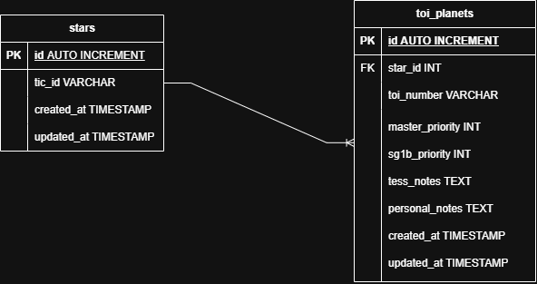

# Ariel TESS Exoplanet Candidates Catalog

Project web berbasis Laravel untuk mengelola dan memvisualisasikan data kandidat exoplanet dari misi TESS (*Transiting Exoplanet Survey Satellite*).

## Fitur Utama
- Katalog Target Exoplanet (Tabel Interaktif)
- Relasi database relasional (*One-to-Many* antara Bintang dan Planet)
- Desain antarmuka bertema *Astro-Terminal* dengan Tailwind CSS

## Database ERD (Entity Relationship Diagram)
Berikut adalah rancangan relasi basis data antara tabel `stars` dan `toi_planets`:

